# 注意力机制（Attention）


在第五章，我们介绍了归一化的基本概念，重点讨论了层归一化LayerNorm公式，以及目前主流LLM使用的简化版RMSNorm公式。我们的推理引擎也已经能计算归一化了，虽然输出还是胡言乱语。到目前为止，我们已经实现了一多半的小模块，如下图所示：

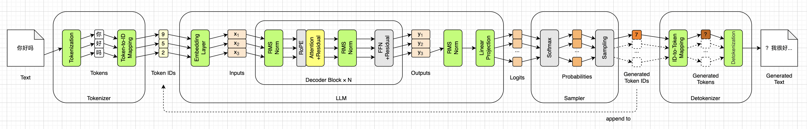

这一章我们来讨论整个LLM的核心：注意力机制。我已经把这个模块涂成了黄色，见上图。和注意力机制密切相关的一个模块是位置编码，为了控制篇幅，我们放到下一章再讨论。

由于注意力机制相对其他内容比较复杂，这一章可能会稍微长一些。我会先简单介绍为什么需要注意力，再介绍什么是注意力。随后给出标准注意力机制的整体计算公式，然后分步拆开讲解这些公式，最后写代码实现注意力机制。由于本书的重点在于LLM推理过程，而非LLM原理，所以我们并不会深入探讨公式背后的原因。想深挖原理的读者，可以从《Attention Is All You Need》这篇论文开始看起。


## 为什么需要注意力

我们暂且先不定义什么是注意力，先看为什么需要注意力。这个问题，我们看看LLM的各个小模块就可以知道答案。下面这个图是放大后的LLM，我们在第一章就见过，这里我重新贴过来，方便参考。

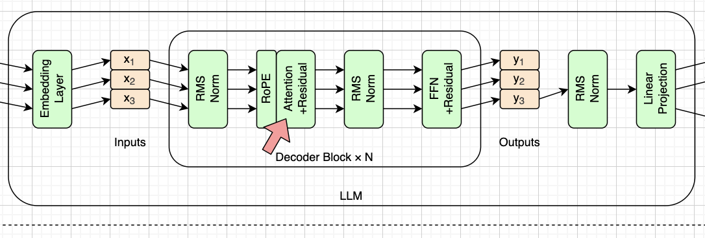

我们知道，一段文字会先被分解为一系列词元，然后通过词表转换为一系列ID。这些ID会在LLM的入口处，转换为一系列词嵌入向量。然后呢，这些向量会被上图显示的这些小模块分别处理。整个过程就像一道流水线，每个模块对这些输入进行一些加工，然后送到下一个模块，最后得到输出。

问题在于，除了上面箭头指向的注意力（包括位置编码，后面不再强调）模块，其他模块都是**单独**处理每一个向量的。换句话说，对于大部分模块来说，向量和向量之间没有任何联系。这显然是个大问题。比如我们阅读一段文字，并不是每个字单独理解，而是把整段文字作为一个整体来一起理解。

所以我们需要一个模块，能够综合考虑所有的输入。而这个模块，就是注意力模块。这里假设只有三个向量，我把上面这个图展开，把模块内部细节画出来，如下图所示。注意看，除了注意力（灰色箭头表示后面的词元注意前面的词元），其他模块都可以看作独立的小模块，分别处理每个输入。

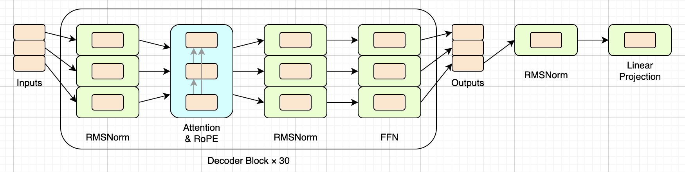

所以呢，注意力模块就是整个LLM里，唯一一处考虑词元之间相互关联的模块。其他地方都是自己算自己，只有注意力会相互看。也就是说，在其他模块里，每个向量根本就不知道其他向量的存在。只有在注意力模块里，词元才会注意到其他词元。更准确地说，是后面的词元会注意到前面的词元，这也正是“注意力”这个名字的直观含义。至于注意力究竟意味着啥，我们下一小节解释。

顺便说一下，这一章我们会混用词元、向量、输入这几个说法，哪个自然就用哪个，它们指的基本是同一个东西：序列里某个位置上的那个576维向量。


## 什么是注意力

那具体而言，究竟什么是**注意力**（Attention）呢？其实就是一种规则：一个词元，如何根据这个规则综合考虑它前面的所有词元，然后算出一个新的向量。可以有很多办法做到这件事，不过最简单的就是加权求和。我们暂且称它为加权求和注意力。

我们来看一个最简单的例子。假设我们只有四个输入，经过注意力机制后，得到四个输出。我们用从输出指向输入的箭头来表示权重，注意箭头的方向和数据流动的方向是反的，它表示的是谁注意谁。第一个输出只需要注意第一个输入即可，于是只有一个箭头。第二个输出需要注意前两个输入，于是有两个箭头。以此类推。由于把所有权重都画在一起，箭头会非常密集，所以我把每个输出的注意力分别画在了自己的图里。这四幅图看起来是下面这样：

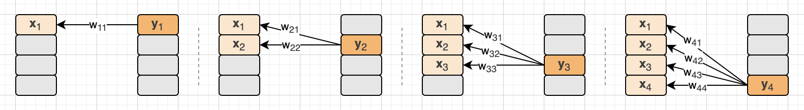

我们用粗体小写字母 $\mathbf{x}$ 和 $\mathbf{y}$ 来表示输入输出向量，用普通小写字母 $w$ 来表示权重，用 $i$ 和 $j$ 来表示向量和权重的下标，那么这个简单的加权求和注意力机制可以用下面这个公式表达：

$$
\mathbf{y}_i = \sum_{j=1}^i{w_{ij} \mathbf{x}_j}
$$

为什么某个词元只看它自己和它前面的词元呢？这是因为LLM干的活，就是根据前面的文字预测下一个词元。推理的时候，后面的词元根本还不存在，想看也看不到。训练的时候倒是整句话都摆在那里，可如果允许偷看后面，模型直接抄答案就行了，什么也学不到。所以训练和推理都遵守同一个约定：每个词元只能看它自己和它前面的词元。这个约定对推理还有一个很大的好处：往序列末尾追加一个新词元时，前面那些位置的计算结果一个都不会变。第十一章的KV Cache，就是靠这一点成立的。这一点我们在讨论因果掩码的时候还会进一步说明。

那么权重怎么来呢？我们先不管，因为这个只是个简化的例子，目的是让你对注意力机制有个大致了解。实际上的注意力机制要比加权求和复杂得多，但本质上仍然是加权求和。你理解了这里，后面就好理解了。

顺便约定一下编号。公式和示意图里的下标都从1开始，比如 $\mathbf{x}_1$ 就是第1个词元，后面会出现的 $\mathbf{Q}_1$ 就是第1个头，这是数学书的习惯。而代码里的编号和Python一样，从0开始。层号是个例外，我们沿用第二章的说法，从第0层开始，因为它直接对应文件里的`model.layers.0`。


## 怎么算注意力

好，现在我们来看标准的注意力公式，它又叫**缩放点积注意力**（Scaled Dot-Product Attention），为什么叫这个名字，我们后面解释。这个公式是2017年著名论文《Attention Is All You Need》提出的。这里我把所有细节都展示出来了，后面讲到GQA时，还会针对SmolLM2的架构再做一点调整。下面是完整的计算公式：

$$
\begin{aligned}
&\left.
\begin{aligned}
\mathbf{Q} &= \mathbf{X} \times \mathbf{W}_Q \\
\mathbf{K} &= \mathbf{X} \times \mathbf{W}_K \\
\mathbf{V} &= \mathbf{X} \times \mathbf{W}_V
\end{aligned}
\quad \right\} \text{线性投影} \\
&\left.
\begin{aligned}
\left[\mathbf{Q}_1, \mathbf{Q}_2, ..., \mathbf{Q}_h\right] &= \mathbf{Q} \\
\left[\mathbf{K}_1, \mathbf{K}_2, ..., \mathbf{K}_h\right] &= \mathbf{K} \\
\left[\mathbf{V}_1, \mathbf{V}_2, ..., \mathbf{V}_h\right] &= \mathbf{V}
\end{aligned}
\quad \right\} \text{拆分} \\
&\left.
\begin{aligned}
\mathbf{O}_i &= \mathrm{softmax}(\mathrm{mask}(
	\frac{\mathbf{Q}_i \times \mathbf{K}^\top_i}{\sqrt{d_k}}
)) \mathbf{V}_i
\end{aligned}
\quad \right\} \text{注意力} \\
&\left.
\begin{aligned}
\mathbf{O} &= \left[\mathbf{O}_1, \mathbf{O}_2, ..., \mathbf{O}_h\right] \\
\mathbf{Y} &= \mathbf{O} \times \mathbf{W}_O
\end{aligned}
\quad \right\} \text{合并、线性投影}
\end{aligned}
$$

这组公式有点复杂，但非常重要，尤其是标着“注意力”的那一行，所以我们要分好几个小节，慢慢把它介绍清楚。


### 输入投影

我们先从比较简单的线性投影入手。线性投影在深度神经网络里无处不在，第四章介绍词嵌入时我们就讨论过。注意力里一共有两处线性投影，我们先来看第一处，也就是前三行公式：

$$
\left.
\begin{aligned}
\mathbf{Q} &= \mathbf{X} \times \mathbf{W}_Q \\
\mathbf{K} &= \mathbf{X} \times \mathbf{W}_K \\
\mathbf{V} &= \mathbf{X} \times \mathbf{W}_V
\end{aligned}
\quad \right\} \text{线性投影}
$$

标准的注意力机制，并不是直接对输入进行加权求和，而是先根据输入，投影出三份向量。上面公式里的粗体大写字母表示矩阵，也就是说，我们用的是矩阵写法。我们把连续T个输入向量当作一个整体来看待，每行一个输入。以T=4为例，下面这幅图展示了向量视角（左）和矩阵视角（右）的差别。下图并没有按比例画，只是为了说明两种视角。

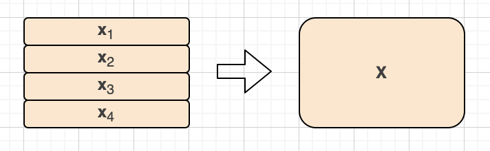

而Q、K、V这三个名字，分别是**查询**（Query）、**键**（Key）和**值**（Value）的首字母，是从信息检索和数据库借来的说法。你可以把它想象成查字典：拿着要查的东西（Query），去和字典里每个词条的索引（Key）比对，哪个对上了，就取出那个词条的内容（Value）。放到注意力里，每个词元都会投影出这三个向量，各扮演一个角色：

| 向量 | 角色 |
| ---- | ---- |
| Q | 我想找什么 |
| K | 我是什么，用来被别人匹配 |
| V | 匹配上了，我能提供什么 |

和查字典不同的是，注意力并不是只取出对上的那一条，而是按匹配程度，把所有的V加权求和。回头看前一小节那个加权求和公式，现在两个问题都有了答案：权重 $w_{ij}$ 来自第 $i$ 个词元的 $\mathbf{q}_i$ 和第 $j$ 个词元的 $\mathbf{k}_j$ 有多匹配，而被加起来的，不再是输入 $\mathbf{x}_j$ 本身，而是它投影出来的 $\mathbf{v}_j$ 。至于“匹配程度”怎么算，第四章已经给过答案了，就是点积，后面马上会看到。

还有一点值得一提，Q、K、V都是从**同一个**输入 $\mathbf{X}$ 投影出来的，只是用了三个不同的权重矩阵，所以这种注意力也叫**自注意力**（Self-Attention）。另外，和词嵌入一样，这三个向量里每一维代表什么，都是训练出来的，“查询”、“键”、“值”只是帮助理解的叫法，不必太当真。由于这个是通用叫法，这里我们就不用粗体了，你知道表示什么意思即可。正文里不加粗的Q、K、V，泛指这三样东西；具体说到矩阵时，我们写成粗体大写的 $\mathbf{Q}$ ；具体说到某个词元的那一行时，写成粗体小写，比如上一段里的 $\mathbf{q}_i$ 和 $\mathbf{k}_j$ 。

那么上面这三个权重矩阵，从哪里来呢？这个咱们在第二章就见过了，它们在Safetensors文件里。这些权重矩阵，每一层都有一套。对于SmolLM2来说，一共30套。我把第0层的JSON元数据贴出来：

```json
  // ... 其他数据 ...
  "model.layers.0.self_attn.k_proj.weight": {
    "dtype": "BF16", "shape": [192, 576], "data_offsets": [61933824, 62155008]
  },
  "model.layers.0.self_attn.o_proj.weight": {
    "dtype": "BF16", "shape": [576, 576], "data_offsets": [62155008, 62818560]
  },
  "model.layers.0.self_attn.q_proj.weight": {
    "dtype": "BF16", "shape": [576, 576], "data_offsets": [62818560, 63482112]
  },
  "model.layers.0.self_attn.v_proj.weight": {
    "dtype": "BF16", "shape": [192, 576], "data_offsets": [63482112, 63703296]
  },
  // ... 其他数据 ...
```

除了前面需要的三个权重矩阵，还多出来一个，是后面那个线性投影需要的，这里就一并展示了。从公式里的大写字母Q、K、V、O，和元数据名称里的小写字母q、k、v、o，你很容易看出对应关系。我把公式中的权重矩阵、JSON元数据中的名称、形状，列了一个表，方便对比：

| 权重矩阵        | 元数据名称 | 元数据中的形状 | 公式中的形状 |
| --------------- | ---------- | -------------- | ------------ |
| $\mathbf{W}_Q$ | `q_proj`   | `[576, 576]`   | `[576, 576]` |
| $\mathbf{W}_K$ | `k_proj`   | `[192, 576]`   | `[576, 192]` |
| $\mathbf{W}_V$ | `v_proj`   | `[192, 576]`   | `[576, 192]` |
| $\mathbf{W}_O$ | `o_proj`   | `[576, 576]`   | `[576, 576]` |

可以看到，Q和O的权重矩阵，刚好是K和V的三倍。这个并不是巧合，和注意力的头数有关，稍后会详细说明。为了直观对比这四个权重矩阵的参数量，我把它们按比例画在了一起。为此，我对这几个权重矩阵都进行了转置，见下图。

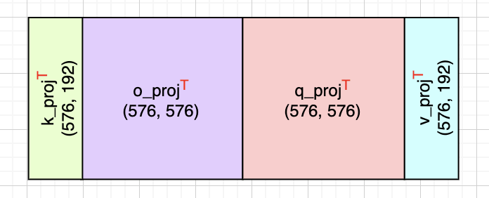

注意，这个转置，在实际计算时也是需要的：文件里的矩阵是按“输出×输入”存放的，而公式里要的是“输入×输出”，所以表格最后两列的形状正好反过来。第四章的线性投影也是同样的道理。另外，上图里四个矩阵是按k、o、q、v的顺序排的，没有按Q、K、V、O，这是为了和上面那段JSON元数据对照：元数据里的张量是按名字的字母顺序排的，第二章讲过这一点。

暂时忽略O，这个投影我们后面再说。由于Q、K、V的三个权重矩阵，都是和同一个 $\mathbf{X}$ 相乘，根据矩阵乘法的特点，我们完全可以把这三个线性投影画在一起，一幅图就够了，不用分开画三幅，如下图所示：

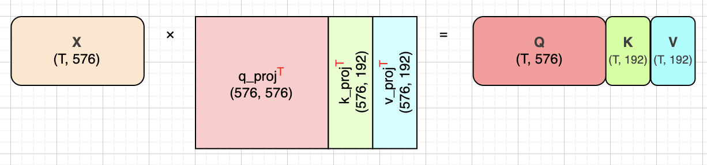

和前面那幅示意图不同，上图是按真实比例画的。我们用圆角矩形来表示输入和输出矩阵，用直角矩形来表示权重矩阵。另外，权重矩阵都是转置过的。每个矩阵的形状，我也都标在了图上，方便对照。


### 注意力头

注意力机制，其实是有多个**头**（Head）的。你不必纠结这个概念，就理解成：其实是有多个注意力机制同时在处理同一份输入，然后得到多组输出。我们把这些输出合并起来，然后再经过一个线性投影，就得到了最终的输出。

这里假设有三个头，那么输入要同时算三次注意力，得到三组输出。我们把这三组输出合并起来，再经过一次线性投影，就得到了最后需要的输出，如下图所示。而这个线性投影，就是后面要介绍的输出投影。

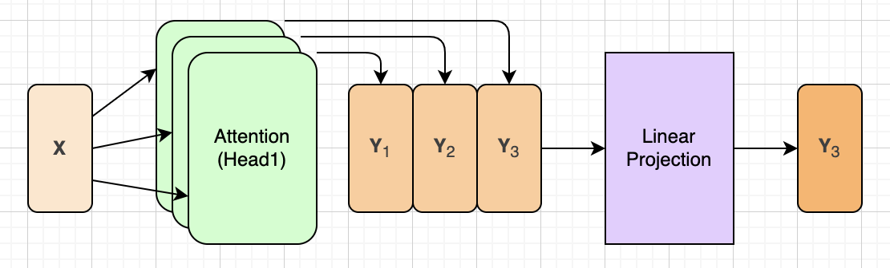

那到底是几个头呢？这个就属于模型的架构了。我们把这个叫做模型的**超参数**（Hyperparameter）。其实模型有多少层（也就是多少个Decoder块），也属于超参数。这些参数都在`config.json`文件里：

```json
{
  /* 其他字段 */
  "num_hidden_layers": 30,
  "num_attention_heads": 9,
  "num_key_value_heads": 3,
  /* 其他字段 */
}
```

可以看到，SmolLM2的层数是30，跟我们从Safetensors文件里读到的信息是一样的。而它的注意力头数是9，此外还有一个奇怪的KV头，数量是3，这是因为SmolLM2使用了一种叫做**分组查询注意力**（Grouped-Query Attention，简称**GQA**）的优化。为了便于区分，我们把注意力头叫做Q头。

等会我们会看到，注意力的计算量和内存开销都不小，尤其是K和V。2017年的原始做法里，每个头都有自己的一组K和V，也就是Q头和KV头一样多，叫做**多头注意力**（Multi-Head Attention，简称**MHA**）。2019年有人提出了一个激进的办法：所有头共用同一组K和V，叫做**多查询注意力**（Multi-Query Attention，简称**MQA**）。MQA省是省了，但通常认为效果会打折扣。2023年提出的GQA取了个折中：把Q头分成几组，每组共用一组K和V。三种做法放在一起，按SmolLM2的9个头来算，是这样的：

| 方案 | Q头 | KV头 | 说明 |
| ---- | ---: | ---: | ---- |
| MHA | 9 | 9 | 原始做法 |
| GQA | 9 | 3 | 折中，SmolLM2用的就是它 |
| MQA | 9 | 1 | 最省，但效果通常会打折扣 |

那GQA到底省了什么呢？先说参数。如果用标准MHA，那K和V的权重矩阵就得和Q一样大，每层要多出442,368个参数，30层就是13,271,040个，差不多是现在整个模型的一成。不过这还不是重点，GQA真正省的是推理时的内存。第十一章我们会看到，推理引擎要把每个词元算出来的K和V都存下来，存多少，直接取决于KV头有多少个。按我们全程使用的FP32来算，8192个词元的上下文，3个KV头要存377,487,360个字节，大约377MB；要是9个KV头，就是三倍，大约1.13GB。所以说，GQA是一个为推理而做的设计，它的价值要到第十一章才能真正看出来。

由于每个注意力头都是单独计算的，都要用到它自己的Q、K、V，所以我们就需要把前面算出来的大Q、K、V拆分。Q就按注意力头数去拆，K和V就按KV头数去拆。每个头分到多少维呢？576除以9，是64维；K和V也一样，192除以3，同样是64维。我们用小写字母 $h$ 来表示注意力头数，用 $g$ 来表示每组有几个Q头共用一组K和V，于是KV头数就可以通过 $h/g$ 算出来。这样，我们就可以把QKV的拆分公式写出来：

$$
\left.
\begin{aligned}
\left[\mathbf{Q}_1, \mathbf{Q}_2, ..., \mathbf{Q}_h\right] &= \mathbf{Q} \\
\left[\mathbf{K}_1, \mathbf{K}_2, ..., \mathbf{K}_\textcolor{red}{h/g}\right] &= \mathbf{K} \\
\left[\mathbf{V}_1, \mathbf{V}_2, ..., \mathbf{V}_\textcolor{red}{h/g}\right] &= \mathbf{V}
\end{aligned}
\quad \right\} \text{拆分}
$$

对于SmolLM2来说， $h=9, g=3, h/g=3$ 。也就是说，每三个Q共用一组K和V。我们可以把前面那幅图里通过矩阵乘法算出来的Q、K、V等比例放大，并且按头数拆分开。下面是拆开后的图：

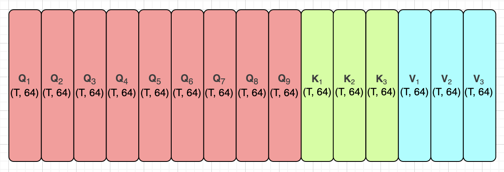

注意看，拆的时候是沿着列的方向切的：每个头拿到的仍然是全部T个词元，只是每个词元只分到其中的64维。我们还可以把Q和KV画在一起，把GQA分组也体现出来，见下图：

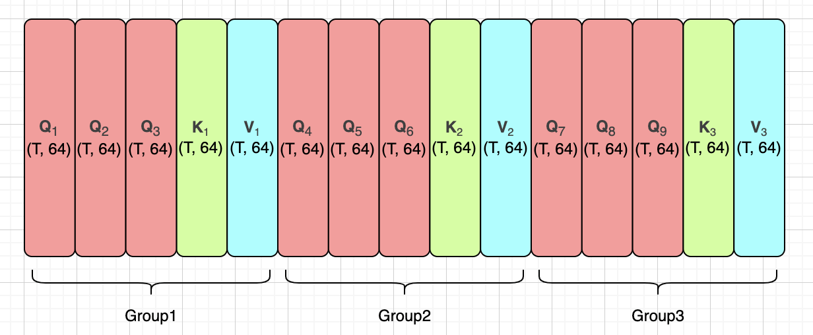

说到这里，你可能会问：为什么要搞这么多头呢？一个头不行吗？

我们回想一下，一个头算到最后，每个词元只能得到一组权重，也就是说，它只有一种“看法”：多看谁，少看谁，就这么定了。可是一句话里的关系往往不止一种。比如“小明把书还给了小红，因为她明天要考试”，读到“她”的时候，我们要回头找“她”指的是谁，这是一种关系；要弄清楚是谁要考试、和“还书”有什么关系，又是另一种关系。让一组权重同时照顾这么多种关系，是很难的。多头的办法很直接：既然一种看法不够，那就同时看好几种，每个头各算各的权重，最后把结果拼起来，交给输出投影去综合。

需要说明的是，每个头具体学会了哪一种看法，并不是人为安排的，而是训练出来的。和第四章说的词嵌入维度一样，有些头的作用能大致看出来，比如专门看前一个词元，但大多数头很难用一句话说清楚它在干什么，你别指望9个头正好对应9种叫得出名字的关系。

还有一点值得注意，多头并不会让计算量翻好几倍。SmolLM2的9个头，并不是各用一套576维的Q、K、V，而是把576维切成9段，每个头只分到64维。所以和只用一个576维的头相比，权重矩阵还是那么大，计算量也差不多，只是同样的576维，被分成了9份，各看各的。


### 矩阵乘法

有了拆分后的Q、K、V，我们就可以看最核心的注意力公式了。我们用小写字母 $i$ 来表示头的下标， $g$ 的概念和前面一样。第 $i$ 个Q头属于第 $\lceil i/g \rceil$ 组（ $\lceil \cdot \rceil$ 表示向上取整），用的是这一组的K和V。比如第1、2、3个Q头用第1组，第4、5、6个Q头用第2组。于是，我们可以写出某个注意力头的计算公式：

$$
\left.
\begin{aligned}
\mathbf{O}_i &= \mathrm{softmax}(\mathrm{mask}(
	\frac{\mathbf{Q}_i \times \mathbf{K}^\top_{\textcolor{red}{\lceil i/g \rceil}}}{\sqrt{d_k}}
)) \mathbf{V}_{\textcolor{red}{\lceil i/g \rceil}}
\end{aligned}
\quad \right\} \text{注意力}
$$

我们暂时先不管公式里的`mask`和`softmax`函数，这个稍后介绍。让我们先聚焦核心的矩阵乘法：

$$
\frac{\mathbf{Q}_i \times \mathbf{K}_{\textcolor{red}{\lceil i/g \rceil}}^\top}{\sqrt{d_k}}
$$

我们以第一个注意力头为例。 $\mathbf{Q}_1$ 的形状是 $[T \times 64]$ ，每一行是一个词元的Q；它对应的 $\mathbf{K}_1$ 也是 $[T \times 64]$ ，转置之后变成 $[64 \times T]$ 。两者相乘，得到一个 $[T \times T]$ 的矩阵，如下图所示：

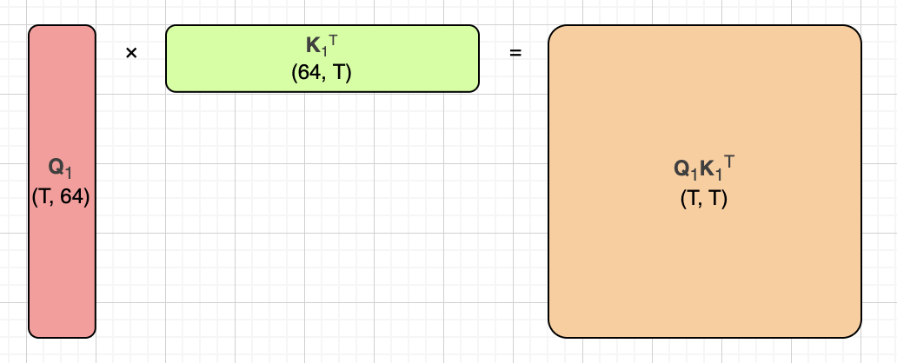

这个矩阵第 $a$ 行第 $b$ 列的那个数，正好是第 $a$ 个词元的 $\mathbf{q}_a$ 和第 $b$ 个词元的 $\mathbf{k}_b$ 做点积。第四章说过，点积可以用来衡量两个向量有多像。所以这个矩阵里装的，就是每个词元的Q和每个词元的K之间的匹配程度，我们把它叫做**注意力分数**。这也是“点积注意力”这个名字的由来。

要特别留意这个矩阵的形状：它的行数和列数都等于序列长度T。序列长度翻一倍，这个矩阵就要变成原来的四倍。整个LLM里，只有注意力的计算量是随序列长度平方增长的，也就是 $O(T^2)$ 的复杂度。第十一章和第十二章做的优化，都是冲着它来的。

剩下的“缩放”，指的就是除以 $\sqrt{d_k}$ 。这里的 $d_k$ 是每个头的维度，也就是K的维度，对SmolLM2来说是64，所以就是除以8。为什么要缩放呢？因为点积是把64对数字分别相乘再加起来，维度越高，加出来的结果往往越大。粗略地说，如果每个分量都是大小在1左右的随机数，那64个乘积加起来，典型的大小就在 $\sqrt{64}=8$ 左右，除以8，正好把它拉回1附近。

如果不缩放，注意力分数就会偏大，等到后面过Softmax的时候，最大的那个会把其他的全部压下去，权重几乎全集中在一个词元上，加权求和就退化成了“只挑一个”。原论文给出的理由和训练有关，这里我们只记住它对推理的影响：这一步不能省，少了它，算出来的数就和训练时对不上。


### 因果掩码

我们上面直接计算了矩阵乘法，因为GPU等硬件非常适合计算这个。但是实际上，我们只需要右边这个矩阵的一半。准确地说，是左下角这一半。因为训练的时候，某个词元只能看到它前面的词元，看不到它后面的词元。这个叫做因果关系。

我们举个例子，比如“好好学习，天天向上！”这句话。为了简单，我们假设一个汉字（包括标点）对应一个词元，一共10个词元。训练的时候，模型要学的就是根据前面的词元，预测下一个词元。这句话可以拆出9道题：看到“好”，要猜出下一个是“好”；看到“好好”，要猜出“学”；以此类推，看到“好好学习，天天向上”，要猜出“！”。下面每一行就是一道题，〇表示被遮住、不许看的部分：

```
好〇〇〇〇〇〇〇〇〇
好好〇〇〇〇〇〇〇〇
好好学〇〇〇〇〇〇〇
好好学习〇〇〇〇〇〇
好好学习，〇〇〇〇〇
好好学习，天〇〇〇〇
好好学习，天天〇〇〇
好好学习，天天向〇〇
好好学习，天天向上〇
```

有意思的是，这9道题并不需要一道一道地做。整句话一次送进模型，前面那个 $[T \times T]$ 的注意力分数矩阵，第 $a$ 行恰好对应第 $a$ 道题，只要把每一行右边不该看的部分遮住，9道题就能并行算完。反过来，要是不遮，第1行就能直接看到第2个“好”，等于看着答案做题，什么也学不到。

这里的答案，就是原文的下一个字，不需要任何人来标注，句子自己就给出了题目和答案，所以这种训练方式叫做**自监督学习**（Self-Supervised Learning）。训练的细节不是本书的重点，我们只要记住结论：模型是在“每个词元只能看前面”的条件下训练出来的，推理时也必须照做，否则算出来的数就和训练时对不上。

为了更好地理解这个问题，我重新画了一幅Q和K相乘的图。这次我们假设只有四个词元，并且把Q和K都画成了向量形式。以 $\mathbf{q}_3$ 为例，它只能注意到 $\mathbf{k}_1$ 、 $\mathbf{k}_2$ 和 $\mathbf{k}_3$ ，看不到 $\mathbf{k}_4$ 。

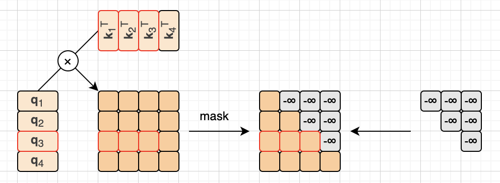

但是我们没必要在矩阵运算上动手脚，我们直接在算出来的矩阵上，把右上角的数据去掉就可以了。通常的做法就是用一个遮罩层，把原来的矩阵盖住。就好比给矩阵戴个面具，所以叫做Mask，中文叫做**掩码**。具体来说，就是把右上角（也就是 $b > a$ ，代表未来的那些位置）的注意力分数，全部换成负无穷，左下角保持不变：

$$
\mathrm{mask}(s_{ab}) =
\begin{cases}
s_{ab}, & b \le a \\
-\infty, & b > a
\end{cases}
$$

为什么是负无穷，而不是0呢？因为掩码是在Softmax之前做的。下一小节会看到，Softmax要先对每个数取指数，而 $e^{-\infty}=0$ ，被盖住的位置权重正好是0；要是换成0，那 $e^0=1$ ，反倒给了未来一个不小的权重。这个错误很隐蔽，程序照样能跑，只是结果莫名其妙地差。

由于盖住的是“未来”，结果只能由“过去”决定，就像先有因、后有果，所以这里叫做**因果掩码**（Causal Mask）。

因果掩码还带来一个好处，就是前面讲加权求和注意力时提过的那个：第 $a$ 行只用到了前 $a$ 个词元。所以往序列末尾追加一个新词元时，这个矩阵只是多出了一行一列，前面那些行一个数都不会变，用不着重算。第十一章的KV Cache正是利用了这一点：把前面算过的结果存起来，每次只算新词元的那一行。而新词元是序列里的最后一个，其他词元都在它前面，它本来就全都能看，没有什么需要遮的，所以到那时候，掩码就整个用不着了。


### Softmax

前一章我们讨论了归一化，Softmax也是一种归一化，而且和RMSNorm一样，也是一个向量一个向量地算。区别在于“归一”的是什么：RMSNorm把向量的均方根变成1，正负号都还在；Softmax则把向量里的数全变成正数，并且让它们加起来等于1，也就是变成一组概率。所以它的中文名也叫**归一化指数函数**。

那为什么这里也需要归一化呢？因为前面算出来的注意力分数，可正可负，大小也没个准，直接拿来当权重是不行的。我们要的权重得满足两个条件：一是不能是负数，二是一行加起来等于1，这样加权求和才是一个真正的“加权平均”。Softmax干的就是这件事：先对每个数取指数，全变成正数；再除以它们的和，让它们加起来等于1。下面是Softmax公式：

$$
\begin{aligned}
\mathbf{z} &= [z_1, z_2, z_3, ..., z_n] \\
\mathrm{softmax}(z_i) &= \frac{e^{z_i}}{\sum_{j=1}^{n} e^{z_j}}
\end{aligned}
$$

在注意力里，Softmax是按行算的：注意力分数矩阵的每一行，单独做一次Softmax，行与行之间互不相干。因为每一行对应一个词元，它要把自己的注意力分给哪些词元，只在自己这一行里分配，所以每一行加起来都等于1。

举个例子，假设某一行的注意力分数是 $[2, 1, -1, -\infty]$ ，最后一个被因果掩码盖住了。取指数之后是 $[7.389, 2.718, 0.368, 0]$ ，加起来是10.475，各自除以它，就得到了 $[0.705, 0.259, 0.035, 0]$ 。可以看到，大小顺序没变，分数高的拿到的权重也高；负数-1也变成了一个正数，只是很小；被盖住的那个正好是0。而且因为取了指数，分数之间的差距会被放大。

Softmax这个名字也很形象：它是一个“软的max”。max只挑出最大的那一个，而Softmax不挑一个，大的多拿，小的少拿，没被盖住的都能分到一点；只是分数之间的差距一大，它就越来越像max，这也是前面缩放那一步要防着的事情。我们把前一小节的图补上Softmax，如下所示：

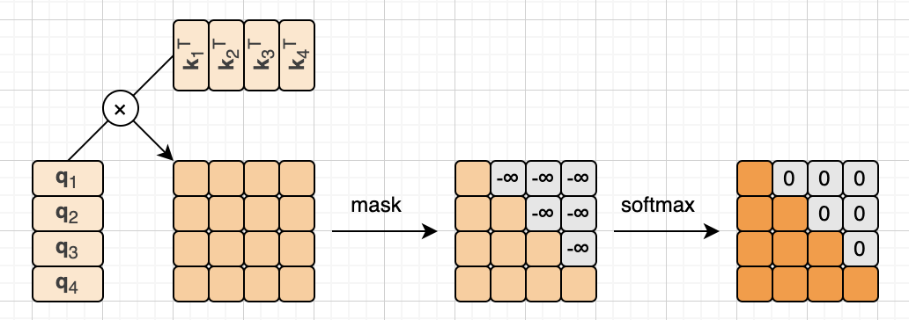

我们在后面多个地方要用到Softmax，比如采样、FlashAttention等等。Softmax也是标准注意力机制最难优化的地方之一，所以有了线性注意力（Linear Attention）等变体，这里就不展开讨论了。


### 加权求和

到这里，我们就有了权重了。我们用这些权重对V进行加权求和，就可以得到每个头的O。这正是前面那个加权求和注意力公式，只不过被加起来的是V，权重是算出来的。核心注意力公式太重要了，所以这里我们再抄一遍：

$$
\left.
\begin{aligned}
\mathbf{O}_i &= \mathrm{softmax}(\mathrm{mask}(
	\frac{\mathbf{Q}_i \times \mathbf{K}^\top_{\lceil i/g \rceil}}{\sqrt{d_k}}
)) \mathbf{V}_{\lceil i/g \rceil}
\end{aligned}
\quad \right\} \text{注意力}
$$

还是以第一个头为例，我们把核心注意力公式完整画出来，看起来是下面这样：

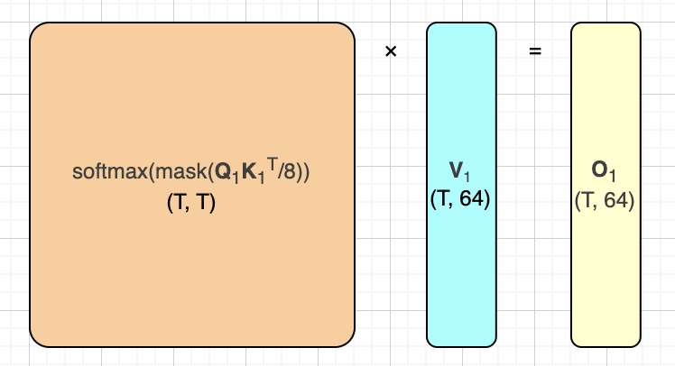

从形状上看，权重矩阵是 $[T \times T]$ ， $\mathbf{V}_1$ 是 $[T \times 64]$ ，两者相乘，得到 $[T \times 64]$ 的 $\mathbf{O}_1$ 。我们把这个矩阵乘法按行拆开来看： $\mathbf{O}_1$ 的第 $a$ 行，就是权重矩阵第 $a$ 行的那 $T$ 个数，分别乘上 $\mathbf{V}_1$ 的 $T$ 行，再加起来。我们用 $\mathbf{o}_a$ 表示 $\mathbf{O}_1$ 的第 $a$ 行，用 $\mathbf{v}_b$ 表示 $\mathbf{V}_1$ 的第 $b$ 行，用 $p_{ab}$ 表示权重矩阵第 $a$ 行第 $b$ 列的那个权重，就可以写成下面这样：

$$
\mathbf{o}_a = \sum_{b=1}^{a} p_{ab} \mathbf{v}_b
$$

求和只加到 $a$ 为止，是因为后面那些位置被因果掩码盖住了，权重都是0，加了也白加。把它和本章开头那个加权求和公式放在一起对比一下，你会发现两者长得一模一样：权重 $w_{ij}$ 换成了算出来的 $p_{ab}$ ，被加起来的 $\mathbf{x}_j$ 换成了投影出来的 $\mathbf{v}_b$ 。绕了这么一大圈，注意力干的事情，说到底还是加权求和。

我们还可以再进一步，把权重 $p_{ab}$ 也展开。它是注意力分数矩阵第 $a$ 行经过Softmax之后的第 $b$ 个数，而那一行的分数，就是 $\mathbf{q}_a$ 和每个 $\mathbf{k}_b$ 的点积再除以 $\sqrt{d_k}$ 。把Softmax公式代进去，就得到下面这个式子：

$$
\mathbf{o}_a = \sum_{b=1}^{a}
\frac{\exp(\mathbf{q}_a \cdot \mathbf{k}_b / \sqrt{d_k})}{\sum_{c=1}^{a} \exp(\mathbf{q}_a \cdot \mathbf{k}_c / \sqrt{d_k})}
\mathbf{v}_b
$$

其中 $\exp(x)$ 就是 $e^x$ ，只是指数部分太长，换个写法看得清楚些。这个式子把一个头里对第 $a$ 个词元做的事情，全都摊在了一行里：分子是 $\mathbf{q}_a$ 和 $\mathbf{k}_b$ 的点积，第 $b$ 个词元能分到多少权重，取决于它的K和第 $a$ 个词元的Q有多像；分母把前 $a$ 个词元的这个值全加起来，保证权重之和等于1；两处求和都只加到 $a$ ，这就是因果掩码。注意，Softmax是对一整行做的，不能拿单独一个点积去算，所以分母里要换一个下标 $c$ ，把这一行都加一遍。

前面说过，标准注意力又叫缩放点积注意力。这个名字里的两样东西，在式子里都看得见：“点积”就是 $\mathbf{q}_a \cdot \mathbf{k}_b$ ，“缩放”就是后面那个除以 $\sqrt{d_k}$ 。这个式子还说明了一件事：第 $b$ 个词元贡献多少，只看它的 $\mathbf{k}_b$ 和 $\mathbf{v}_b$ ，和它排在第几位没有关系。这一点下一章讲位置编码时还会用到。

我们看一个真实的例子。下面是我们这一章的引擎里，输入“Once upon a time”时，第0层第1个头的权重矩阵的第3行，也就是第3个词元`Ġa`的那一行（这一行出自随书源代码里的`inspect_attn.py`）：

```
    0.211  0.099  0.690  0.000
```

所以 $\mathbf{o}_3 = 0.211\,\mathbf{v}_1 + 0.099\,\mathbf{v}_2 + 0.690\,\mathbf{v}_3$ 。也就是说，`Ġa`在这个头里，把69.0%的注意力给了自己，21.1%给了`Once`，9.9%给了`Ġupon`，而后面的`Ġtime`被因果掩码盖住了，一点都分不到。由于现在还没有位置编码，这几个数本身没什么可解读的，看个意思就行。

最后还有一点值得强调。注意力里用到的四个权重矩阵 $\mathbf{W}_Q$ 、 $\mathbf{W}_K$ 、 $\mathbf{W}_V$ 、 $\mathbf{W}_O$ ，训练完就固定下来了，不管输入什么，都是同一套。而这里的权重 $p_{ab}$ 不一样，它是每次推理时根据输入当场算出来的，输入换一句话，权重就跟着变。不同的头、不同的层，算出来的权重也各不相同。就拿GQA来说，第1、2、3个头虽然共用同一个 $\mathbf{V}_1$ ，但它们的Q不同，算出来的权重不同，加权求和的结果自然也就不同。注意力之所以能“看上下文”，靠的就是这组随输入而变的权重。


### 输出投影

最后还有一个线性投影。但是在投影之前，要先把这些 $\mathbf{O}_i$ 合并起来，看作一个整体。公式里的 $\mathbf{W}_O$ ，我们在前面的权重表里已经见过了。下面是合并和投影公式：

$$
\left.
\begin{aligned}
\mathbf{O} &= \left[\mathbf{O}_1, \mathbf{O}_2, ..., \mathbf{O}_h\right] \\
\mathbf{Y} &= \mathbf{O} \times \mathbf{W}_O
\end{aligned}
\quad \right\} \text{合并、线性投影}
$$

先看合并。9个头各自算出一个 $[T \times 64]$ 的 $\mathbf{O}_i$ ，我们把它们左右并排拼在一起，就得到了一个 $[T \times 576]$ 的 $\mathbf{O}$ 。这正好是拆分的逆过程：当初怎么把576维切成9段，现在就怎么把9段接回576维。下面是图：

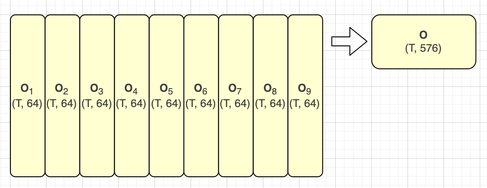

注意，左边那9个 $\mathbf{O}_i$ 沿用了前面拆分时放大的比例，而右边的 $\mathbf{O}$ 又缩回了原来的比例，所以看起来比左边小了一圈，实际上它就是左边9块拼起来的样子。

再看投影。拼起来的 $\mathbf{O}$ 再乘上 $\mathbf{W}_O$ （也就是`o_proj`转置后的样子，形状是 $[576 \times 576]$ ），得到最终的输出 $\mathbf{Y}$ ，形状仍然是 $[T \times 576]$ ，和输入 $\mathbf{X}$ 一模一样，所以能直接加回主干上，这就是上一章说的残差连接。

这一步还有一个作用：合并只是把9个头的结果并排放着，每个头仍然只管自己那64维；乘上 $\mathbf{W}_O$ 之后，输出的每一维都综合了所有9个头的结果，各个头算出来的东西，这才真正混合在一起。我们把输出投影也画出来，如下所示：

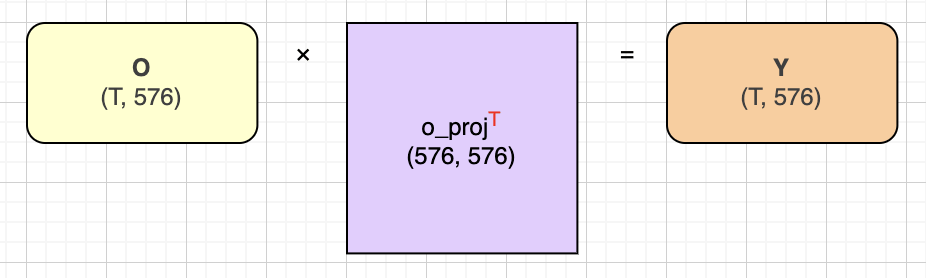

到这里，整组注意力公式就全部讲完了。回顾一下：先把输入投影出Q、K、V，再按头拆开；每个头各自算注意力分数、缩放、加因果掩码、过Softmax，再对V加权求和；最后把各个头的结果合并起来，做一次输出投影。我们把整个过程画在一张图里，从左到右，正好对应上面那组公式：

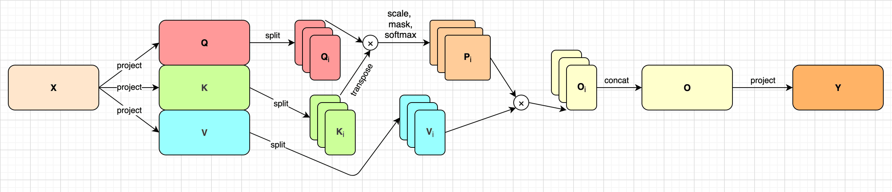

图里的 $\mathbf{P}_i$ 是第 $i$ 个头过完Softmax之后的权重矩阵，它第 $a$ 行第 $b$ 列的那个数，就是前面说的 $p_{ab}$ 。另外，为了画得简单，图里只画了3个头，而且每个头都有自己的一组K和V，这其实是MHA的画法。SmolLM2用的是GQA，9个Q头共用3组K和V，只是多了一步把K和V复制给几个Q头共用，其余的数据流和图上完全一样。


## 代码实现

看懂了公式，下面我们来写代码，把注意力计算添加到推理引擎里。和上一章一样，`Engine`类一行都不用动，要改的只有`Config`和`Model`两个类。先来看`Config`类：

```python
        # 第六章新要的两个。q有9个头，k和v只有3个头，这就是GQA。
        self.num_attention_heads = self.raw["num_attention_heads"] # 9
        self.num_key_value_heads = self.raw["num_key_value_heads"] # 3
```

因为注意力要知道切几个头，所以我们在上一章的基础上，再给两个字段起名字。每个头多少维，`config.json`里并没有单独的字段，用576除以9算出来就行。

然后是这一章的重点，`Model`类的`attn()`方法。前一章它只是返回随机数，现在要换成真的注意力了。它比上一章多了一个参数`layer`，因为注意力要用到这一层自己的四个权重矩阵。这个方法比较长，我们分几段来看。第一段，先把要用到的几个数准备好，然后做三次线性投影：

```python
    def attn(self, x, layer):
        T = x.shape[0]
        n_heads = self.config.num_attention_heads     # 9
        n_kv_heads = self.config.num_key_value_heads  # 3
        head_dim = self.config.hidden_size // n_heads # 576 / 9 = 64

        # 三次线性投影。权重按(out, in)存放，所以要转置。
        q = x @ layer["q_proj"].T # (T, 576) → (T, 576)
        k = x @ layer["k_proj"].T # (T, 576) → (T, 192)
        v = x @ layer["v_proj"].T # (T, 576) → (T, 192)
```

这里的`x`是已经过了RMSNorm的输入，形状是`(T, 576)`，T就是这一串有多少个词元。三次投影对应公式的前三行，`.T`就是前面说的那个转置，和第四章`to_logits()`里的写法一样。第二段是拆头：

```python
        # 拆头：先把最后一维切成(头数, 64)，再把头挪到最前面。
        q = q.view(T, n_heads, head_dim).transpose(0, 1)    # (9, T, 64)
        k = k.view(T, n_kv_heads, head_dim).transpose(0, 1) # (3, T, 64)
        v = v.view(T, n_kv_heads, head_dim).transpose(0, 1) # (3, T, 64)
```

这三行可能不太好懂，我们拿一个缩小的例子来看：2个词元，3个头，每个头2维，所以每个词元一共6个数。为了好认，每个数就写它自己的编号，其中10和11写成了a和b，免得两位数把格子撑宽。下图从左到右，就是`q`经过`view()`和`transpose()`的样子：

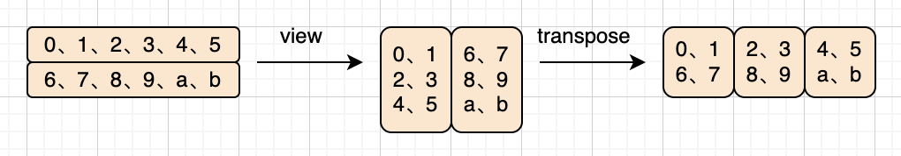

最左边是投影出来的`q`，形状是`(2, 6)`，一行一个词元。前面说过，代码里的编号从0开始，所以这里的头0就是公式里的第1个头。每一行其实已经包含了3个头的数据：0、1属于头0，2、3属于头1，4、5属于头2，只是首尾连在一起，看不出边界。

中间是`view(2, 3, 2)`之后的样子。一个三维张量，可以理解成叠在一起的一组矩阵：第一维说的是有几个矩阵，后两维是每个矩阵的行和列。所以`(2, 3, 2)`就是2个`(3, 2)`的矩阵，每个词元一个，矩阵的3行对应3个头，2列对应每个头的2维。`view()`做的事情，就是每2个数切一刀，把头和头之间的边界划出来。注意，`view()`并不挪动数据，内存里还是那12个数，变的只是怎么去读它们。

最右边是`transpose(0, 1)`之后的样子。它把前两维对调，形状从`(2, 3, 2)`变成`(3, 2, 2)`，也就是3个`(2, 2)`的矩阵，每个头一个，矩阵的2行对应2个词元。对比一下中间和右边：中间是“先按词元，再按头”，要拿头0的数据，得去每个词元的矩阵里各取一行；右边是“先按头，再按词元”，头0的数据就整整齐齐地放在一个矩阵里。

换成真实的数字，`view()`把`(T, 576)`变成`(T, 9, 64)`，`transpose()`再把它变成`(9, T, 64)`，也就是9个`(T, 64)`的矩阵，正好就是公式里拆出来的 $\mathbf{Q}_1$ 到 $\mathbf{Q}_9$ 。

为什么要把头挪到最前面呢？因为PyTorch的矩阵乘法只拿最后两维相乘，前面的维度都当成“有几组”，每组各算各的。头在最前面，9个头就会自动各算各的，不用写循环。第三段是GQA：

```python
        # GQA：每个kv头连续复制3份，排成[0,0,0,1,1,1,2,2,2]，对齐9个q头。
        # 写成k.repeat(3, 1, 1)会排成[0,1,2,0,1,2,0,1,2]，形状一样，不报错，全错。
        group = n_heads // n_kv_heads         # 3
        k = k.repeat_interleave(group, dim=0) # (3, T, 64) → (9, T, 64)
        v = v.repeat_interleave(group, dim=0) # (3, T, 64) → (9, T, 64)
```

由于K和V只有3个头，而Q有9个头，为了让它们一一对上，最简单的办法就是把K和V每个头复制3份。这里有个坑，注释里也写了：一定要用`repeat_interleave()`，让每个头**连续**复制3份，排成`[0,0,0,1,1,1,2,2,2]`，这样第1、2、3个Q头对上的都是第1组K和V，正好就是公式里那个 $\lceil i/g \rceil$ 。要是写成`repeat()`，就会整组重复3遍，排成`[0,1,2,0,1,2,0,1,2]`，形状一模一样，程序也不报错，但配对关系全错了。顺便说一下，复制只是为了代码好写，真正的推理引擎不会这么干，第十一章存K和V的时候，存的仍然只是3个头。第四段是注意力的核心，和公式一一对应：

```python
        # 每个头各算一张T×T的分数表：第a行第b列是词元a的q和词元b的k的点积。
        scores = q @ k.transpose(1, 2) / head_dim ** 0.5 # (9, T, T)

        # 因果掩码：右上角（b > a，也就是未来）置成-inf，softmax之后正好是0。
        future = torch.ones(T, T, dtype=torch.bool).triu(1) # (T, T)
        scores = scores.masked_fill(future, float("-inf"))

        probs = torch.softmax(scores, dim=-1) # (9, T, T)，每行和为1
        out = probs @ v                       # (9, T, 64)
```

第一行先算Q乘以K的转置，再除以 $\sqrt{64}$ 。`k.transpose(1, 2)`把每个头的K从`(T, 64)`转成`(64, T)`，乘出来每个头一张`(T, T)`的注意力分数表，9个头就是`(9, T, T)`。

接下来两行是因果掩码。`triu(1)`取的是对角线以上的那个三角，也就是右上角，这些位置是`True`，代表未来；`masked_fill()`把它们统统换成负无穷。然后`softmax()`沿着最后一维，也就是按行，把注意力分数变成权重。最后用这些权重对V加权求和，得到9个头各自的输出。最后一段是合并与输出投影：

```python
        # 拼头：把头挪回去，9个64维首尾相接拼回576维，再过o_proj把各头混合起来。
        out = out.transpose(0, 1).reshape(T, n_heads * head_dim) # (T, 576)
        return out @ layer["o_proj"].T # (T, 576) → (T, 576)
```

这正好是拆头的逆过程：先`transpose()`把词元挪回前面，再把9个64维首尾相接，拼回576维。注意这里用的是`reshape()`而不是`view()`。拆头的时候，数据在内存里本来就是按这个顺序排的，`view()`划一下边界就行；而`transpose()`之后，按新的顺序去读，在内存里就不再是挨着的了，这时候`view()`会直接报错。`reshape()`在不用挪数据的时候不挪，必须挪的时候会复制一份重新排好。最后乘上`o_proj`的转置，把9个头的结果混合起来，输出的形状和输入一样，还是`(T, 576)`。

我们把`attn()`写完了，`block()`方法只需要改一个地方，就是把`layer`传给`attn()`：

```python
    def block(self, x, layer):
        x = x + self.attn(self.rms_norm(x, layer["input_norm"]), layer)
        x = x + self.ffn(self.rms_norm(x, layer["post_attn_norm"]))
        return x
```

另外一个空位`ffn()`，这一章我们也顺手改一下，让它不再返回随机数，而是返回全0：

```python
    def ffn(self, x):
        return torch.zeros_like(x)
```

为什么要改呢？因为随机数会把注意力的效果全部淹没，那样我们就看不出注意力到底有没有在干活。返回0之后，`block()`里第二行就成了`x = x + 0`，FFN这个子层等于不存在，看到的就只是注意力的效果。注意，这里不能偷懒直接返回`x`，因为`ffn()`收到的是归一化之后的`x`，原样返回的话，每一层都会往主干上再加一份。


## 代码效果

代码写完了，我们来跑一下引擎。还是输入“Once upon a time”，下面是`engine.py`的输出（中间省略了几行）：

```
输入   'Once upon a time'
词元   ['Once', 'Ġupon', 'Ġa', 'Ġtime']
ID     [6403, 1980, 253, 655]
...
  第 5个词元   ID 49064   'ppo'
  第 6个词元   ID 49064   'ppo'
...
  第14个词元   ID 49064   'ppo'
...
输出   'Once upon a timeppoppoppoppoppoppoppoppoppoppo'
```

又是复读！不过这次和第四章不太一样。第四章复读的是输入里的`Ġtime`，因为中间一层都没有，它自己和自己最像；这次复读的`ppo`，输入里根本没有。而且换个输入，结果也会跟着变，说明前面的词元确实参与了计算，注意力在干活。

那为什么会卡在`ppo`上呢？简单地说，是因为现在的注意力几乎是在给整句话求平均。它的权重分得很平均，30层走下来，各个位置被抹成了差不多的样子：刚查出来的词嵌入，两两之间的余弦在-0.111到0.322之间，而30层走完之后，全都在0.983以上。所以送到出口的，其实是整句话的平均。出口拿着这个平均去词表里找最像的，`ppo`那一行的模长有4.441，比别人大一截，按余弦它只排第86，按点积却排第一，这和第四章`Hello`被`<filename>`抢走是同一件事。挑中`ppo`之后，把它追加到序列末尾，整句话的平均几乎不变，下一圈挑出来的还是它，于是就一直重复下去了。

上面这些数字，都出自随书源代码里的`inspect_attn.py`脚本。至于注意力为什么会退化成平均，要等后面两章补上RoPE和FFN之后才看得清楚。

最后说一下，怎么知道代码写对了。前面几章我们都会和`transformers`比一比，可这一章比不了，因为它的注意力带着RoPE，而我们的还没有。好在PyTorch自带了一个`F.scaled_dot_product_attention()`函数，正好就是“没有位置信息的因果注意力”。随书源代码里的`check_attn.py`脚本，就拿它和我们的`attn()`做了对比，两边只差浮点数的舍入误差，读者可以自己跑一下。


## 本章小结

这一章做了四件事。

第一，弄清了为什么需要注意力，以及注意力是什么。整个LLM里，只有注意力会让词元之间互相看，其他模块都是自己算自己。注意力的本质是加权求和：每个词元把它自己和前面所有词元的向量按权重加起来，算出一个新的向量。只看前面，是因为推理时后面的词元还不存在，这也让往序列末尾追加新词元时，前面的计算结果保持不变。

第二，把缩放点积注意力的公式拆开看了一遍。输入先投影出Q、K、V三份，Q去和K匹配，按匹配程度对V加权求和。具体分五步：Q乘以K的转置得到注意力分数，除以 $\sqrt{d_k}$ 做缩放，用因果掩码把未来盖住，过Softmax变成一行加起来等于1的权重，最后对V加权求和。9个头各算各的，合并回576维之后，再经过一次输出投影，把各个头的结果混合起来。

第三，认识了GQA。SmolLM2有9个Q头，却只有3个KV头，每3个Q头共用一组K和V。它省下了一些参数，但更重要的是省下了推理时存K和V的内存，这一点要到第十一章才能真正看出来。

第四，把这些写成了代码。我们给`Config`补了两个字段，把`attn()`从随机数换成了真正的注意力，又让`ffn()`暂时返回0。我们用`check_attn.py`和PyTorch自带的注意力对了一下，两边只差浮点数的舍入误差。引擎现在是：

```
ids → embed → [norm → attn → norm → □] × 30 → norm → lm_head → logits
```

不过输出还是不通顺：给它“Once upon a time”，它会一直重复`ppo`。原因我们也看清了，注意力几乎在给整句话求平均，各个位置被抹成了一个样，模长大的词元又占了便宜。注意力还有一个先天的缺陷：它只做加权求和，而加法是不分先后的，所以它分不清词序。下一章我们就来补上位置编码。
